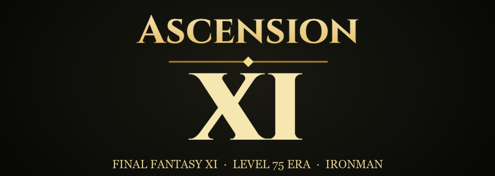
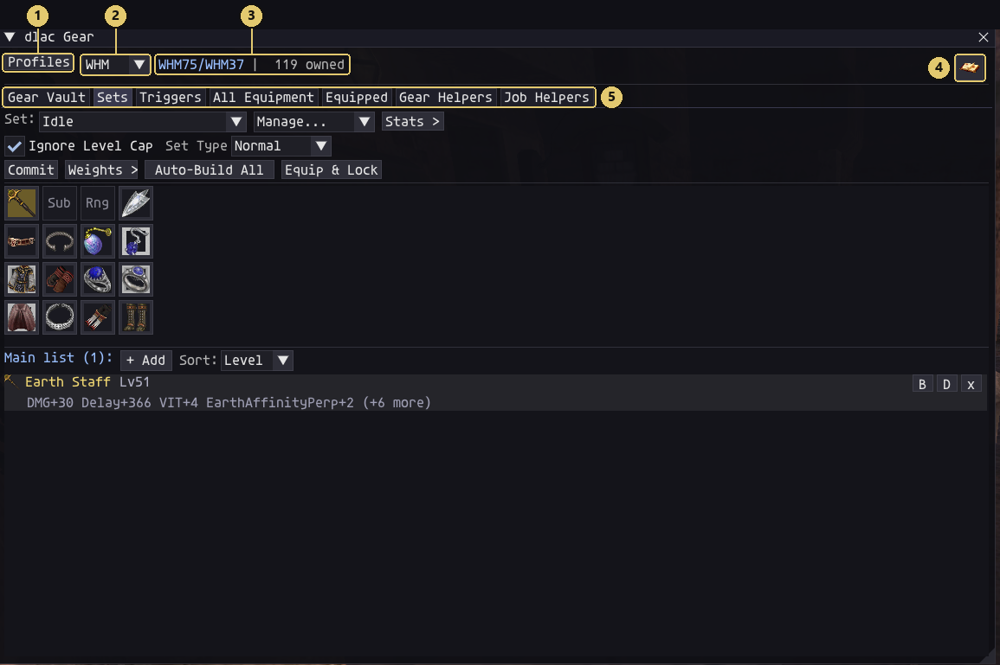
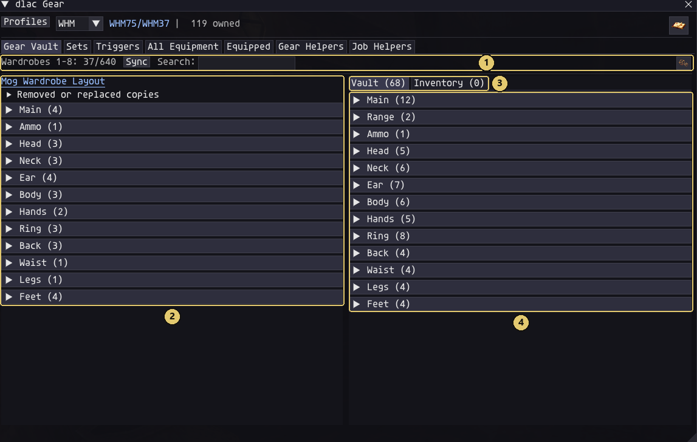
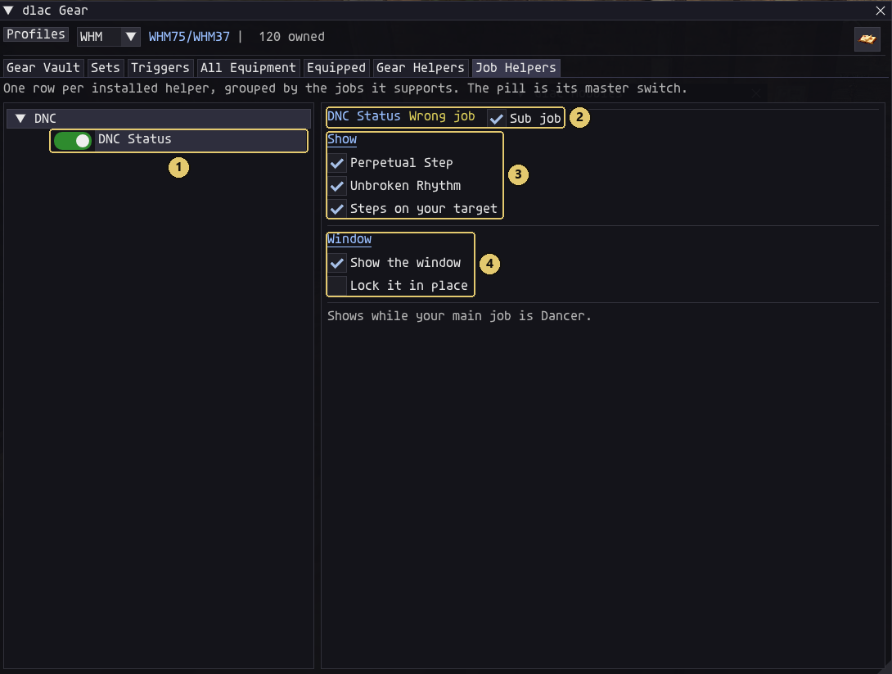
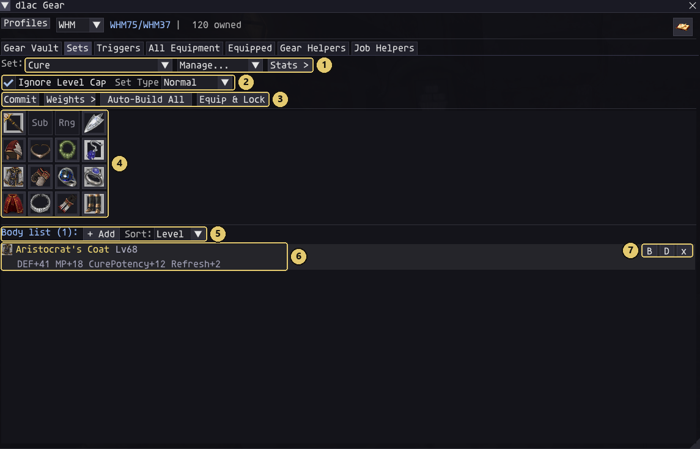
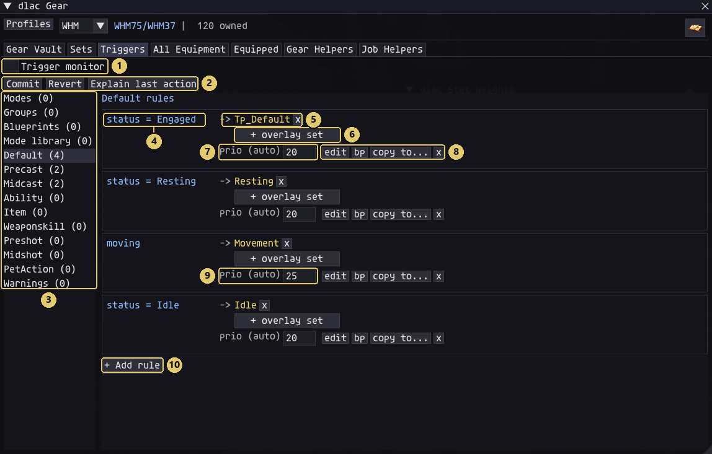
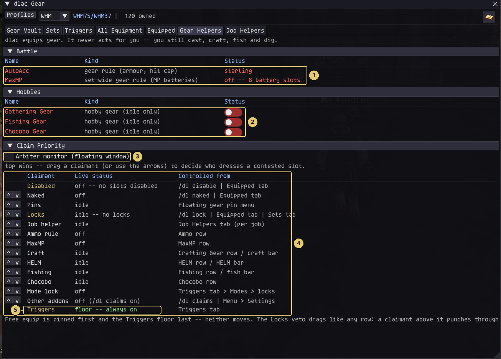
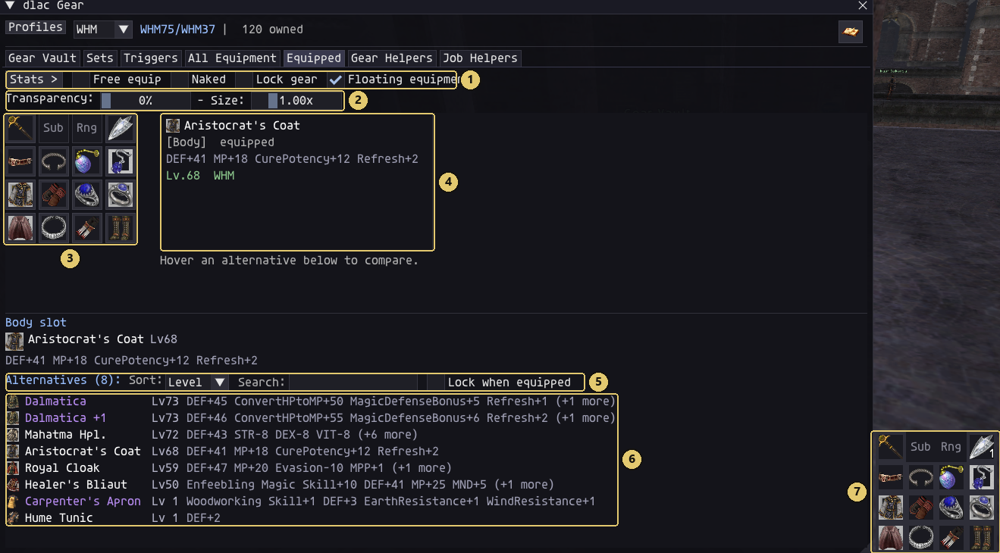
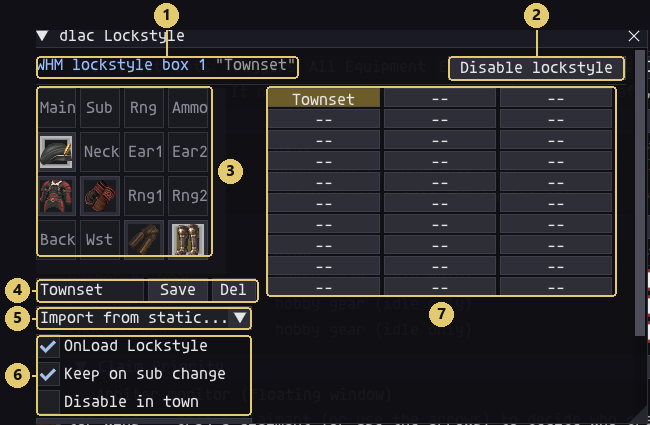
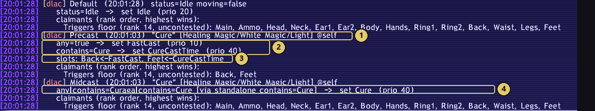



# DLAC

**The gear addon for AscensionXI.** 
Build your sets once, and DLAC wears the right gear at the right moment while you play.

[![AscensionXI addon][badge-axi]][axi-site]
[![CatsEyeXI supported][badge-cexi]][cexi-site]
[![Ashita v4][badge-ashita]][ashita]
[![Guide on the AscensionXI wiki][badge-wiki]][wiki]
[![Join us on Discord][badge-discord]][discord]

**[Read the full guide on the AscensionXI wiki][wiki]** · [Playing on CatsEyeXI?](#playing-on-catseyexi)

---

Welcome! DLAC is a gear manager that runs inside Final Fantasy XI. You put your gear
into **sets**, you tell DLAC **when** to wear each set, and it swaps your gear for you
while you play. No Lua files, and no macros full of `/equip` lines.

DLAC is made for **[AscensionXI][axi-site]** and grows together with it. The Gear Vault,
AutoAcc and the job gauges are built hand in hand with the server, and the launcher
installs DLAC for you. DLAC also runs on **[CatsEyeXI][cexi-site]**, where everything
under [Everyday DLAC](#everyday-dlac-on-both-servers) works just the same.

   
  The DLAC window: (1) your profiles, (2) the job picker, (3) your job, level and how much gear you own, (4) the Menu, (5) the tabs.

## What you get on each server

| | AscensionXI | CatsEyeXI |
| --- | :---: | :---: |
| Sets, triggers, modes and Blueprints | ✅ | ✅ |
| Gear Helpers: MaxMP, gathering, fishing and chocobo gear | ✅ | ✅ |
| Lockstyle, macro books and teleports | ✅ | ✅ |
| Job Helpers | ✅ WHM, PLD, DNC | ✅ BLU (Bludex) |
| Installed and kept up to date by the launcher | ✅ | download the ZIP |
| [Gear Vault](#gear-vault) | ✅ | — |
| [AutoAcc](#autoacc) | ✅ | — |
| [Crafting gear for Nexus](#more-with-the-servers-own-numbers) | ✅ | — |
| Fish, digs and gathered items moved to your Mog Case or Satchel | ✅ | — |
| [CatsEyeXI's own systems](#extra-on-catseyexi): giftbox opener, NM Compendium | — | ✅ |

---

## Made for AscensionXI

> **AscensionXI** is an Ironman Final Fantasy XI server from the level 75 era, where you
> party up, take on challenges together, and earn your own gear.
> *Play together. Earn your own.*
>
> **[Visit ascensionffxi.com][axi-site]** · **[Join us on Discord][discord]**

These parts of DLAC talk to the AscensionXI server directly, so you'll only find them there.

### It's already installed

You probably have DLAC already. The AscensionXI launcher installs it, keeps it up to date
and turns it on the first time. Press **Ctrl+K** (or type `/dl ui`) to open it. If you'd
rather not use it, switch it off in the launcher's **Addons** tab.

### Gear Vault

DLAC is the easiest way to use your Gear Vault. You need The Deeper Room done first.

- Each job has its own **Mog Wardrobe layout**: the gear that job keeps in its wardrobes.
- Gear your sets use goes into that layout by itself, and from there into your wardrobes
  the next time you're in town. **Pin** anything else you want to keep there.
- When your wardrobes are full, DLAC offers you your least-used pieces to take out.
- At a Gear Vault counter, **Store all** puts every storable piece in your bags into the
  vault in one go.
- Vaulted gear shows in **violet** all through DLAC, and you can put it straight into a set.

   
  (1) wardrobe space, Sync, Search and options, (2) this job's Mog Wardrobe layout, (3) Vault and Inventory, (4) everything you've stored.

### AutoAcc

The server tells DLAC how much accuracy you need against the monster you're fighting.
Give your accuracy pieces the **AutoAcc** gear rule, and once the rest of your gear
already reaches the hit cap, DLAC swaps them for the slot's next best piece. You keep
hitting, and you stop spending slots on accuracy you don't need. It works for ranged
attacks too.

Type `/dl accuracy` to see your hit rate against your target and what AutoAcc is wearing.

### Job gauges and helpers

- **White Mage**: a flower gauge that appears by itself while Afflatus Solace or Misery is up.
- **Paladin**: a gauge for Divine Guard and Divine Fury (your five points, the bar toward
  the next one, and your Palisade stacks), plus **Divine Elements**: what the divine
  elements on your weapon add to each weapon skill, and the cheapest way to each level 2
  skillchain.
- **Dancer**: **DNC Status** keeps track of Perpetual Step, your Unbroken Rhythm stacks and
  the Steps on your target.
- **Stances count**: Red Mage, Paladin and Warrior sets can count their stance's gear
  bonuses (Composure, Divine Guard, Divine Fury, Berserk and more), and a piece can wait
  for a stance before it goes on.

They show you what's going on. They never use an ability for you.

   
  The Job Helpers tab, with DNC Status switched on.

### More, with the server's own numbers

- **Crafting gear for Nexus**: if you craft with Nexus, DLAC puts your best crafting gear
  on before every synth, starting with the weakest craft the recipe needs.
- **Fishing**: your Fishing points, the gear Fennella sells, and a fish lookup (which rods
  won't break, where it swims, with which bait). Your catch can move into your Mog Case or
  Mog Satchel by itself.
- **Gathering**: your HELM points and your chance of an extra roll, and your gathering
  gear goes on when you're near a HELM point.
- **Chocobo digging**: your digging skill, dig delay and allowance, with Gysahl Greens
  counted in Void Storage too.
- **EXP bands**: right-click your Chariot, Empress or Emperor Band to recharge it at a Gear Vault.

---

## Everyday DLAC, on both servers

Everything from here on works the same on AscensionXI and CatsEyeXI.

### New to gear sets? Start here

If you've never swapped gear before, these few ideas are all you need.

- **A slot** is one of the 16 places gear goes: main hand, sub, ranged, ammo, head, neck,
  two earrings, body, hands, two rings, back, waist, legs and feet.
- **A set** is a list of gear for some of those slots. A "Cure" set holds the pieces that
  make your Cures heal more.
- **A set only changes the slots it names.** A set with just a pair of boots in it only
  changes your feet. That's how sets stack: you wear your Idle set, and a Movement set
  with only boots goes on top of it while you run.
- **A trigger** is a rule that says when a set goes on, like "when I'm resting, wear my
  Resting set". DLAC checks your rules all the time and swaps gear by itself.

### Your first set in five minutes

Every job starts with four empty sets (Idle, Tp_Default, Resting and Movement) and the
rules that wear them. Nothing happens until you put gear in them.

1. Press **Ctrl+K** and click the **Sets** tab.
2. Next to **Set:**, pick **Idle**.
3. Click a slot in the grid, click **+ Add**, and click a piece of gear. Do that for every
   slot you want.
4. Press **Commit**. It turns red while you have changes that aren't saved yet.
5. That's it. Your Idle gear goes on whenever you're standing around. Do the same for
   **Tp_Default**, and you have a fighting set too.

### Sets

  

- Pick from everything you own. A slot can hold several pieces, and DLAC wears the best
  one you can at your current level, so a level sync just falls back to the next piece.
- **Auto-build** picks the best set from your gear, based on the stats you tell it you
  care about.
- **Copy from** turns your old LuaAshitacast sets into DLAC sets. **Copy to** sends a set
  to your other jobs.
- **Equip & Lock** wears a set and holds it there until you unlock.
- **Mode Gates** wear a piece only while a mode is on, like your Treasure Hunter gloves.

### Triggers: when your sets go on

  

Each rule is a set of **conditions** and the **set** to wear when they're true. Every rule
that matches fires, so sets stack: your Fast Cast set goes on for every spell, and Cure
Clogs go on top of it for Cures.

Rules can look at your status, whether you're moving or in town, the spell's name, skill,
magic type or element, the day and weather, your HP, MP and TP, your buffs, your pet and
your modes, joined with **and** and **or**. A change to a rule works on your very next
action, with no reload.

### Modes

A mode is a switch you flip with a button, a key or a macro (`/dl mode TH`).

- **Toggles** (TH, DT) are on or off: put your damage-taken set over everything while DT is on.
- **Cycles** (Weapon: Melee → Ranged → Caster) step through a list, and your rules follow
  the one that's active.

### Blueprints: share rules like macros

Save any rule as a **Blueprint** and stamp it onto your other jobs. Blueprints travel as
plain text, so you can paste a friend's rules into your own game.

### Gear Helpers: gear that picks itself

  

DLAC equips gear. It never acts for you: you still cast, craft, fish and dig.

- **MaxMP** keeps your highest-MP pieces on while your MP is full, and hands each slot
  back to your set as your MP drops.
- **Gathering**, **Fishing** and **Chocobo** gear go on while you're idle, one hobby at a
  time, with a floating **Hobby bar** for quick switching.
- **Claim Priority** decides who wins when two parts of DLAC want the same slot. Drag a
  row to reorder it, and open the **Arbiter monitor** to see who put on each piece.

### Equipped and All Equipment

  

- **Equipped** shows what you're wearing right now with your stat totals. Hover an
  alternative to compare it, with gains in green and losses in red, and click to put it on.
  The **floating equipment** window keeps your gear on screen.
- **All Equipment** lists everything you own, with filters, search and stats. Tick
  **Show gear I don't own** to see what you're still missing.
- **Free equip** (`/dl disable`) lets go of every slot while you change gear by hand.

### Lockstyle, macro books and teleports

  

- **Lockstyle**: build your look in 30 boxes per job, preview gear you don't own yet, and
  have it put on when you log in. It can stay on through subjob changes, or step aside in town.
- **Macro book**: DLAC switches your macro book and page when you change job or subjob.
- **Teleports**: click a warp ring, a teleport earring or an EXP ring, and DLAC equips it,
  waits until it's ready, and uses it.

### When something looks wrong

  

- `/dl why` explains your last gear change: which rules matched and which set won each slot.
- The **Trigger monitor** lists the rules that fired, live.
- `/dl check` shows which version you're running and whether everything loaded.
- `/dl report` records what DLAC does for five minutes and writes one file you can attach
  to a bug report. Nothing is sent anywhere on its own.
- The windows are gone? Press **Scroll Lock**. It hides DLAC together with the game's own HUD.

### Extra on CatsEyeXI

DLAC also knows CatsEyeXI's own systems:

- **Giftbox opener** (`/dl giftbox`): opens every reward box in your inventory, one at a
  time, and never into a bag that can't hold what comes out.
- **NM Compendium** (`/dl nm`) and the **Wishlist** (`/dl wish`), for the gear you're hunting.
- **Bludex** for Blue Mage: every spell, a set planner and trait ladders. Also available
  as a [standalone addon](https://github.com/henkpoa/bludex).
- **Elemental Staff**, **Elemental Obi**, **Oneiros Grip**, **Ammo** and **Crafting** gear helpers.

---

## Getting started

### Playing on AscensionXI

There's nothing to install: the launcher already did it. Log in, press **Ctrl+K**, and
follow [your first set in five minutes](#your-first-set-in-five-minutes). The
**[DLAC guide on the AscensionXI wiki][wiki]** goes through every button, with pictures.

New to AscensionXI? **[Start at ascensionffxi.com][axi-site]** and come say hi on **[Discord][discord]**.

### Playing on CatsEyeXI

1. Download **`dlac-cexi-<version>.zip`** from this repository's
   **[Releases](https://github.com/henkpoa/dlac/releases)**. Take the named CEXI ZIP, not
   GitHub's "Source code" archive.
2. If you have an older DLAC, type `/addon unload dlac`, then back up and **replace** the
   whole `Ashita\addons\dlac` folder. Don't unpack over the old one.
3. Unpack the ZIP into `Ashita\addons`, so you end up with `addons\dlac\dlac.lua`.
4. Type `/addon load dlac`, and add that line to your Ashita boot script so it loads every time.
5. Press **Ctrl+K**.

DLAC equips gear itself, so **don't run it together with LuaAshitacast**. Type
`/addon unload luashitacast` and take it out of your boot script. Your old LuaAshitacast
files are never changed: bring your sets over with **Manage → Copy from...** on the Sets tab.

The CatsEyeXI ZIP picks the CatsEyeXI server by itself. Keep `config\addons\dlac` when
you update: your sets, rules and settings live there.

## Commands

`/dl` (or `/dlac`):

| Command | What it does |
| --- | --- |
| `/dl ui` | Open or close the window (same as **Ctrl+K**) |
| `/dl why` | Explain the last gear change. `/dl why <slot>` explains one slot |
| `/dl mode <name>` | Flip a mode, or move a cycle to its next value. `/dl mode` lists the modes that are on |
| `/dl disable`, `/dl enable` | Free equip: hand your slots back to you, or give them back to DLAC |
| `/dl naked`, `/dl dress` | Take everything off and keep it off, then go back to normal |
| `/dl lock set <name>`, `/dl lock set off` | Wear a set locked, then unlock it |
| `/dl lock all off` | Release every lock |
| `/dl prio` | Show the Claim Priority order |
| `/dl sync` | Look for new gear in your bags right now |
| `/dl ls` | Open Lockstyle |
| `/dl w`, `/dl iw`, `/dl ir`, `/dl c` | Use your Warp Ring, Instant Warp, Instant Retrace or Chocobo Whistle. Add `off` to cancel |
| `/dl t <where>` | Use a teleport item for that place. With no place, it lists what you own |
| `/dl xp <ring>` | Use an EXP ring or band |
| `/dl unused` | Gear sitting in your Mog Wardrobes that nothing asks for |
| `/dl check` | Which version you're running, and whether everything loaded |
| `/dl report` | Record five minutes of what DLAC does into one file you can send |
| `/dl reload` | Reload DLAC |
| `/dl accuracy` | **AscensionXI:** your hit rate against your target, and what AutoAcc is wearing |
| `/dl vault why <item>` | **AscensionXI:** everything DLAC knows about one piece of gear |
| `/dl craft nexus on`, `off` | **AscensionXI:** crafting gear for Nexus synths |
| `/dl giftbox` | **CatsEyeXI:** open every reward box in your inventory |

Your sets, rules and settings are saved for each character in
`Ashita\config\addons\dlac\`, with backups of every set you save.

---

## For developers

DLAC is one Ashita v4 addon with **server packs**: everything that belongs to one server
lives in `servers/<id>/` ([ADR 0035](docs/adr/0035-server-packs.md),
[pack contract](docs/reference/server-pack-contract.md)). AscensionXI is
`servers/ascensionxi/`, CatsEyeXI is `servers/cexi/`, and the shared engine and windows
stay server-neutral. The public CatsEyeXI ZIP is built from this same source; see
[CEXI packaging](docs/reference/cexi-release.md).

**Start at [docs/HANDOFF.md](docs/HANDOFF.md)**: environment, hard rules and current
state, with a reading order. Then [CONTEXT.md](CONTEXT.md) (glossary),
[docs/architecture.md](docs/architecture.md) (module map and data flow),
[docs/adr/](docs/adr/) (decision records) and
[docs/design/trigger-system.md](docs/design/trigger-system.md) (the trigger engine).

**Writing a Job helper?** Copy [docs/templates/example-helper/](docs/templates/example-helper/)
into `jobhelpers/<job>/<your-module>/` and read the
[Job helper authoring guide](docs/reference/jobhelper-authoring-guide.md).

| Path | What lives there |
| --- | --- |
| root | `dlac.lua` (entry) and the engine: `utils`, `dispatch`, `chatfmt`, `profiles`, `gear` |
| `ui/` | the windows (`gearui`, `triggersui`, `uihost`, ...) |
| `gear/` | the gear pipeline (`gearimport`, `gearoptim`, `setmanager`, `serverpack`, ...) |
| `feature/` | self-contained features (`lockstyle`, `craftwatch`, `useitem`, ...) |
| `lib/` | generic helpers |
| `jobhelpers/` | drop-in Job helper modules, `<job>/<module>/` |
| `servers/` | the server packs: data, modules and feature defaults per server |

## License

MIT — see [LICENSE](LICENSE).

 

**DLAC is made for [AscensionXI][axi-site].** Come play with us: **[ascensionffxi.com][axi-site]** · **[Discord][discord]**

[axi-site]: https://www.ascensionffxi.com
[wiki]: https://www.ascensionffxi.com/wiki/DLAC
[discord]: https://discord.gg/e924EXBC6m
[cexi-site]: https://catseyexi.com
[ashita]: https://www.ashitaxi.com
[badge-axi]: https://img.shields.io/badge/AscensionXI-addon-c9a24b?style=for-the-badge&labelColor=17130c&logo=data:image%2Fpng;base64,iVBORw0KGgoAAAANSUhEUgAAACAAAAAgCAYAAABzenr0AAAERUlEQVR4AeyWW2icRRTH59tNdlNNuk0kVRQsrU1qSi6ajUXwlogvom%2FWPhTUNpQk3tBovGCjDcV7KVYpwTQXAz4o8YIgFkRL0hq8UJOaah5kY0MpEUxML9bsdzlnZjyzm9mdby9ECm1fEvJn5vvmd%2F5z5pzZZQPsMv8tJ7BcgeUKXP4KnJvqW38m1tu4pE70rdFfGdPTHxTl48%2FHBsrP%2FtHfkG9dv5d%2F9lyh%2FAKR9TumGLjTlsDWgIDhXApaWFG6bsdJFaC0du12J8zYFLGfkoYDEg8FBG9aFYKJkormuci6kmMBITcm1jI8g5J3WDZMWNe2xpVXogWlG584Gal8dKtA%2BwuBDsuhMwo2teKcOC3RBsVKcDojG9p2WWseS3CWtYVHNrR0S3Rm1bopDxbeWVWb5JRfIgE1sSwmPeG0MW7PkzEzJbz43vkfu1YqTuts4exuMr5GcueHyOT3b%2Bv35kgH8kwfNQ9J1zGZVALq5dU1O%2F9i6LZTIFXBTgvs62UI3lKM0tz48w2Cu08RZ3MZ325t%2BYSr95kS3PDA5BzB9mG%2BBNRKaf3uD6VwDkoK9gnt1rmjHY1yuKtAIu%2BlzQss6XSW1736u4rLJXVinwd5MmqxyWYloBYDMt5G%2FfuHNklXAR1LwELfbHj2FTK%2BiUo%2FWhYt3qf4fCIPIz5ZAaBKmHzOBK7a1H1KCvsFZeCXewM9v0ybx5m10GxZXcI0y5xTonSXHJ%2FYUi3QJqtvG%2BihPo9wcFmmBDh7V986GNNsvhExO%2FZ%2FtUAZqk8FB9nCEekfGWJaAHyzPHgvfRUoMr8QwBeX9ABfQM4WaMLznPsAMIhAm%2FtVdYKv2KW5fCMCZ%2BiPYyoJk8%2BbQOyz%2B%2Bsp%2BE3Sv4hwPHEadaJFAeJzijHNMucUSwlQFRZjlAcdyIflTOC3ocZi4OIjMghLgU8HUG6lPrj0zLQ4YIHHxcDPPdFCn6PxQImneB2n3hkIy5kAeoXdlGklcv75jQ981V%2Bx%2BctJD%2FjrKRNItaQuVFz2omloztFLcelE6C6ZTFYC44NNDwvOHxKIMyEPWzSM5%2F9%2Bg6pwnMT84juP9jVWa84c%2FRwm4qgbJuKvwE8Hbq9E5PupvAK52Fb1yKF5TTe0joGUXjMC2aYrwKhSYclE%2F9DQg0HN6hENLjXPV4Gv99Reybn4mMASAN57S%2FPIt9pIj9Fto2MI3vvEpEua3GTTdadnOjSnR2pBOJMFxynS62oMSMmsI%2Fvqa4vC4W8Q4GYSmbsre3JcLkmnBA9Lkoz%2FdnOA1w6%2FF%2B38rrumVHGH3214nC5ceRbrwjOKUZsrBY7sj1ZzKcoEh5c4h6ak8EBVnNUowNTwqalqIWAwyWh2cUS4R3A%2Bim6wbmQmdocQOMlTfouMeha4RzH06Un%2BIrrrybFfm9p%2FGcnUne1j4%2Bbman73s8cmMrkLfaY7FVeeWZ8C9fJSajmBi16Bpdr5HwAAAP%2F%2FJTg5DgAAAAZJREFUAwCluFh9W0z3LAAAAABJRU5ErkJggg%3D%3D
[badge-cexi]: https://img.shields.io/badge/CatsEyeXI-supported-3f8f6b?style=for-the-badge&labelColor=17130c
[badge-ashita]: https://img.shields.io/badge/Ashita-v4-6b7b8c?style=for-the-badge&labelColor=17130c
[badge-wiki]: https://img.shields.io/badge/Guide-wiki%2FDLAC-c9a24b?style=for-the-badge&labelColor=17130c
[badge-discord]: https://img.shields.io/badge/Discord-join%20us-5865F2?style=for-the-badge&labelColor=17130c&logo=discord&logoColor=white
