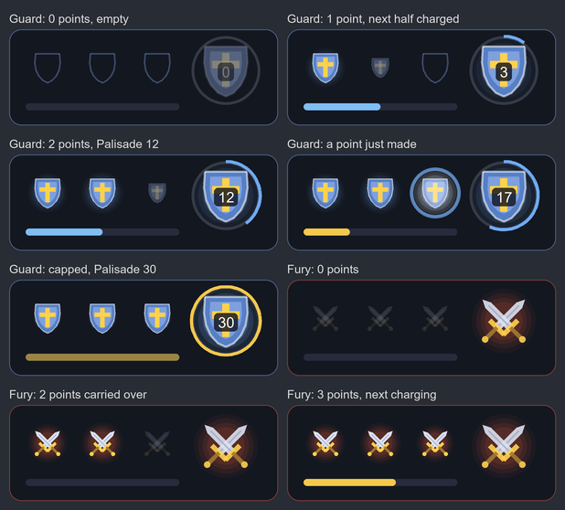

# Paladin Divine Guard gauge (AscensionXI)

**Status, 2026-10-24:** built and tested headless (`tests/ascensionxi_pldgauge.lua`), not yet
seen in game. The server half is on the AXI branch `claude/pld-divine-guard`
(`modules/custom/lua/pld_divine_guard.lua`, contract in `job_gauge_wire.lua`, design record
`documentation/custom/pld-divine-guard.md`). It is not in the game until AXI merges and deploys
it; for a playtest, the branch runs on the local shard.

## What it is

*Offline render of `draw.panel`'s actual draw-list calls at scale 1.5: recorded in Lua,
painted with PIL. The in-game anti-aliasing differs slightly.*

AscensionXI gives the Paladin two stances, **Divine Guard** (tank) and **Divine Fury**
(offensive), and three points. In Divine Guard every shield block fills half a point and a
Shield Bash that interrupts a monster's spell or TP move gives a whole one; Palisade, Sacred
Ward and Martyr's Grace spend them. The points carry over a stance swap (owner, 2026-10-24).

The owner asked for the White Mage gauge's frame with new icons, so this is that frame:

- **Three point slots** in a row and a **charge bar** under them.
  - Divine Guard: each point is a heater shield, steel blue with a gold cross.
  - Divine Fury: each point is a pair of crossed great swords on a crimson glow.
  - The next empty slot shows a dim icon that grows with the charge, and bursts into light
    when the point is made.
  - The bar is the stance colour toward a point, gold while it fills behind three points,
    and pulses gold once that is full too (CAPPED: blocks fill nothing until a point is spent).
- **The big shield on the right** (Divine Guard) carries the **Palisade stack count** (0-30),
  with a ring that fills toward the cap and turns gold at 30. In Divine Fury the big element
  is the crossed swords, with no count: leaving Divine Guard ends Palisade.

dlac draws it **passively**: no tab and no Job helper row. The gauge appears by itself while
the main job is PLD and a stance is up, and hides otherwise.

## Files

| File | Role |
|---|---|
| `servers/ascensionxi/modules/pldgauge/init.lua` | Ashita glue: shared 0x1E0 gate, the slot-2 tap (0xD2, 0xDA blocked before decoding), zone and unload edges, the window, `/dl gauge` for a main Paladin, `<char>\dlac\pldgauge.lua` settings |
| `.../pldgauge/wire.lua` | Pure codec. The contract is the AXI repo's `job_gauge_wire.lua`; a shared 14-byte vector is pinned in both suites |
| `.../pldgauge/gauge.lua` | Pure client state: when to subscribe, the Palisade buff check, what to draw (`view()`) |
| `.../pldgauge/draw.lua` | The art. Draw-list shapes only (no textures): the shield and each blade are convex polygons filled by `PathFillConvex`, with a triangle-fan fallback |
| `.../pldgauge/demo.lua` | `/dl gauge demo` on a Paladin: a 40 s loop through every state, no server needed |
| `servers/ascensionxi/modules.lua` | Mount list (`pldgauge` added) |
| `servers/ascensionxi/transport.lua` | `producerOf` names slot 2 `pld gauge`, its own turn in the shared gate |
| `servers/ascensionxi/modules/whmgauge/init.lua` | `/dl gauge` yields to the Paladin gauge on a main Paladin |
| `tests/ascensionxi_pldgauge.lua` | Headless suite (in CI) |

## The channel

Slot 2 of the job gauge partition (slot = op % 8): `SUBSCRIBE` 0xD2, `STATE` 0xDA. STATE is
14 bytes: proto, job (7), stance (0 none, 1 Divine Guard, 2 Divine Fury), points (0-3),
Palisade stacks, Palisade cap (30), flags (0x01 CAPPED), a zero byte, then u16 charge,
threshold and rev. The White Mage gauge's tap blocks the whole partition but reads only its
own two ops, the Dancer's and this module's taps read only their own slot, so the three never
take each other's frames (the suite delivers each slot's frames through all three taps).

## Packet budget (the AutoAcc lesson)

The client asks for nothing it can see itself: its job and level, the stance buffs (icons 654
Divine Guard, 655 Divine Fury, which the server sends) and the Palisade buff (478). The server
sends only the points, the charge and the stack count.

- **One request per zone,** only while the main job is Paladin, 3 s after zone-in. The server
  keeps the subscription in a local variable, so a zone-out ends it.
- **Pushes only on a change,** coalesced by the server to one within 250 ms.
- **Unknown or old servers cost almost nothing:** `BAD_OP` or `UNAVAILABLE` silences it for
  the session, `BUSY` retries after 2 s, silence backs off 5, 15 and 60 s, then stops.
- **Nothing is drawn until the server has sent a state,** so an AscensionXI server without the
  Paladin slot shows nothing.
- **Hiding the gauge** (`/dl gauge hide`) also stops the requests; **unload** sends a stop.

## Rules the client applies

- **No stance trust rule.** The White Mage's flowers wither on a stance switch, so that gauge
  waits for the server to agree; a Paladin's points carry over, so they are drawn under either
  stance at once (`view().agree` says whether the server has seen the stance yet).
- **Palisade needs its buff.** The stack count is drawn only while the client sees the
  Palisade buff. The server does not push when Palisade runs out or is lost to death, so
  without this check the big shield would keep showing stacks that are gone.

## Commands

`/dl gauge` is shared with the White Mage gauge: on a main Paladin this module answers it,
on every other job the White Mage gauge does. It toggles the gauge (`show`, `hide`) and takes
`lock` / `unlock`, `scale N` (0.6-3), `demo` and `status`. The position is remembered once a
drag settles.

## Field checks owed

With the AXI branch running on the local shard and this branch as the client's dlac:

1. Divine Guard shows the gauge; Divine Fury keeps the points and swaps the icons.
2. Blocks fill the bar (half a point each) and make points; a Shield Bash that interrupts a
   spell or TP move adds one.
3. Palisade: each use counts up on the big shield; the count empties when Palisade ends.
4. Three points and a full bar pulse (capped); spending a point empties the bar into the slot.
5. The art reads well at scale 1 and 1.5, and Scroll Lock hides it with the game HUD.
6. `/dl gauge status` on a Paladin answers for this gauge; on a White Mage for theirs.

Stub-imgui tests can't catch width or font problems. A screenshot is the test for those.
