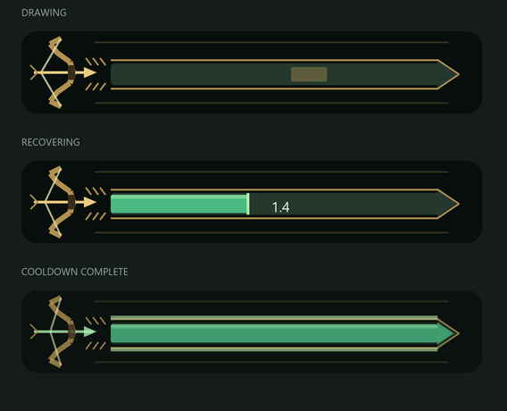

# Ranger recovery gauge (AscensionXI, AXI-162)

Implemented for local playtesting. Requires the paired server changes in
AscensionXI PR #1399. It is mounted only by the AscensionXI pack. CatsEyeXI
does not load it. No automatic firing, gear changes or new combat rules.

The preview records `draw.panel` calls, then rasterizes them offline. Labels
outside the panels describe the preview. The game gauge has no Ready label.
In-game antialiasing and font placement still need owner acceptance.

## Interaction

On main RNG20+, a green arrow fills during ranged recovery. A recurve bow
and brass edging identify the job without a permanent text label. Drawing
uses a small amber sweep. After the shot, the green fill and tenths-of-a-second
countdown show recovery. Full gets a brief highlight, then becomes quieter.
Melee swings and melee weapon skills can start recovery too.

The bar shows weapon recovery, not all possible reasons an attack might fail
(range, ammo, status effects, another action). It does not issue attacks.
Drag it to move. Hover explains the current phase. `/dl gauge` toggles it on
Ranger. `show`, `hide`, `lock`, `unlock`, `scale 1.5`, `demo` and `status` work
like the existing job gauges. Position, size and visibility are per character.
Death, zoning and other jobs hide it. An old server leaves it hidden.

## Authority and traffic

`rnggauge/wire.lua` owns slot 3, subscribe 0xD3 and push 0xDB, in the existing
0x1E0 channel. STATE is 14 bytes: u8 protocol=1, job=11, enabled, phase
(0 idle, 1 aiming, 2 recovery), u32 remaining milliseconds, u32 total
milliseconds, u16 revision. Packet padding is outside the payload.
Shared vector: `01 0B 01 02 FC 08 00 00 CC 10 00 00 FF FF`.

Subscribe once after login/zone/job eligibility changes. Hide/unload stops it.
The server registers existing RANGE_START and RANGE_STATE_EXIT listeners,
plus RANGED_COOLDOWN from the existing melee-recovery assignment. The latter
covers melee swings and executed melee WS. Events coalesce into one deferred
read after the native action transition. There is no periodic server listener,
database query, client timer request or per-frame network traffic. Normal
shots send two state changes. Rejected spam and idle waiting send none.

The server reads its native aim, return, free-phase and anti-weave deadlines.
DLAC interpolates the returned remaining time with the existing monotonic
transport clock. Network delivery can make the bar finish a little late,
never intentionally early. It never guesses Rapid Shot procs or gear delay.
Sequence matching, revision ordering and bounded old-server retries mirror
the existing transport. Zoning discards pending state. Aim stays aiming until
the server resolves or cancels it, even if its predicted time elapses.

## Entry points and verification

- `servers/ascensionxi/modules/rnggauge/{init,gauge,wire,draw}.lua`: Ashita
  adapter, state machine, codec and geometry.
- `servers/ascensionxi/modules.lua`: AXI-only mount.
- `servers/ascensionxi/transport.lua`: distinct producer for slot 3.
- `servers/ascensionxi/modules/whmgauge/init.lua`: shared command yields on RNG.
- `tests/ascensionxi_rnggauge.lua`: shared vector, interpolation, subscriptions,
  rejection of stale/malformed data, long cooldowns, bounded retries,
  job/zone/hide lifecycle, renderer and pack isolation.
- `tests/render_rnggauge.lua`: records the actual renderer for offline preview.

Focused tests passed with LuaJIT, alongside PLD and WHM gauge tests. The main
suite passed 8201 checks and UI smoke passed 1849 with Lua 5.4. The main test
file uses Lua 5.4 syntax, so it cannot run under LuaJIT unchanged. New runtime
files and focused tests do run under LuaJIT.

Delivery is a repository commit pinned by the paired AXI addon catalog, then
installed through that catalog. Never author changes in an installed addon.
The local playtest requires a rebuilt map server and `/addon reload dlac`.
No texture or client DLL change is involved. Roll back the addon catalog
pin and remove this pack's mount to hide the gauge. It never changes shot
timing. Remaining verification is owner visual acceptance in the real client.
